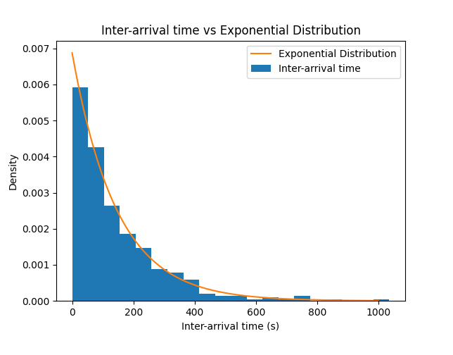
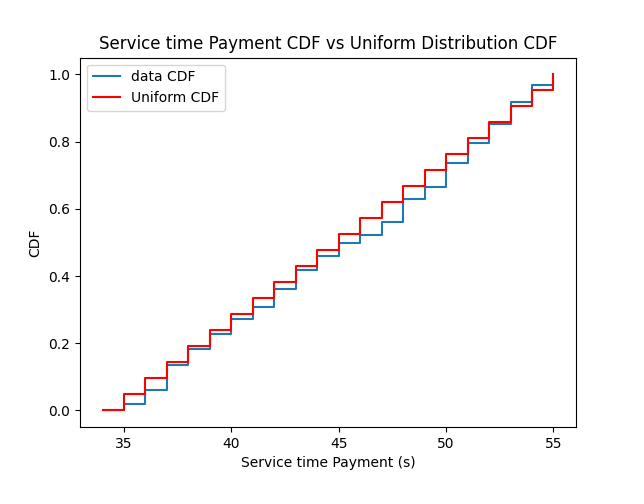

# Gas Station Simulation: The Cost of Blocking at the Pumps

A discrete-event simulation of a four-pump gas station with a shop and a single cashier, driven by a day of observed data, that measures how much the layout of the pumps costs customers.

**TU/e · Stochastic simulation coursework**

<!-- REPORT_LINK -->

## Problem

The station has two lanes, each with a front and a rear pump. Reaching a front pump means passing the rear pump, so an occupied rear pump blocks it, and a car at a rear pump cannot leave while the front pump is occupied. Some drivers insist on one side of the station, and the rest take the first suitable pump, in first-come first-served order. After fuelling, some customers visit the shop, and everyone pays at a single cashier.

## Approach

- **Trace-driven simulation:** one observed day (395 cars, 06:00–22:00) with arrival times, fuel, shop and payment times, and side preferences, replayed through an event-driven model of the pumps, the shop and the cashier.
- **Input modelling:** a fitted distribution for each input: exponential inter-arrival times (mean 146 s), gamma fuel times (mean 276 s), exponential shop times (mean 69 s) and uniform payment times on 35–55 s, checked with histograms, empirical CDFs and a Kolmogorov–Smirnov test. 17.7% of customers shop, 8.9% insist on the left side and 9.9% on the right.
- **Stochastic simulation:** the same model driven by the fitted distributions over many independent days, with 95% confidence intervals.
- **Scenarios:** the current layout; no blocking, where cars can reach and leave any pump freely; and paying at the pump, with no shop visit or cashier queue.

## Results

On the observed day:

| Scenario | Mean wait for a pump | Mean time at the station |
|---|---|---|
| Current layout | 170 s | 538 s |
| No blocking | 50 s | 391 s |
| Pay at the pump | 143 s | 488 s |

- Blocking is the main bottleneck. Removing it cuts the wait for a pump by about 70% and the time at the station by about 27%.
- Paying at the pump saves about 50 s per visit. Pumps free up sooner, and there is no shop visit or cashier queue, though the cashier queue only averages about 5 s on the current layout.
- The stochastic version ranks the three scenarios the same way.

  <em>Input modelling: inter-arrival times against the fitted exponential density, and payment times against the fitted uniform CDF.</em>

## Repository contents

- `src/GasStation/`: the trace-driven model. `Simulation.py` is the current layout, `SimulationScenario1.py` removes blocking and `SimulationScenario2.py` moves payment to the pump. `DataFitting.py` analyses the input data, and `Car`, `Event`, `FES`, `FuelPump`, `GasStationQueue` and `SimResults` are the building blocks.
- `src/GasStationWithoutdata/`: the same three scenarios driven by the fitted distributions, with replications and confidence intervals.

From `src/`, run a module such as `python -m GasStation.Simulation`. The trace-driven scripts read `data/gasstationdata.xlsx`, which is not included (`data/` is git-ignored).

**Tools:** Python · pandas · NumPy · SciPy · statsmodels · Matplotlib
